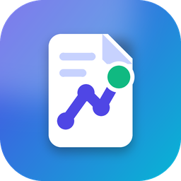
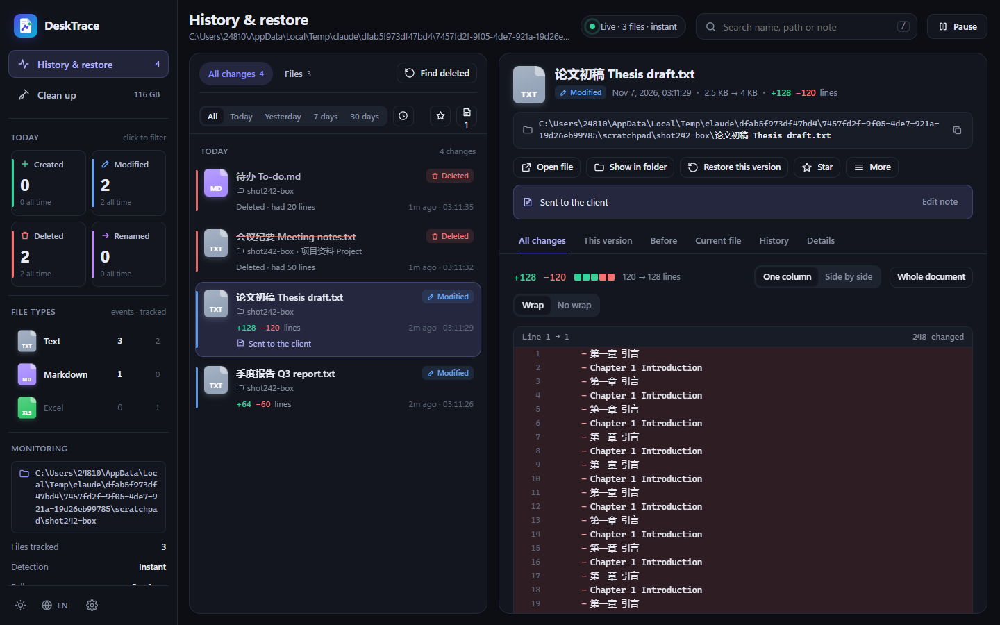
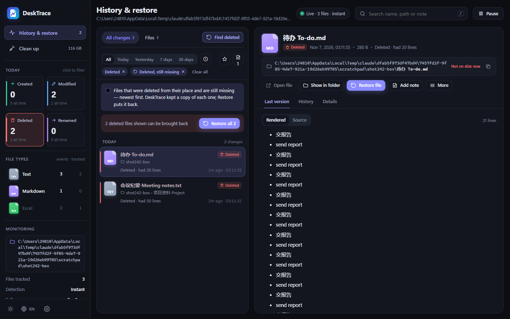
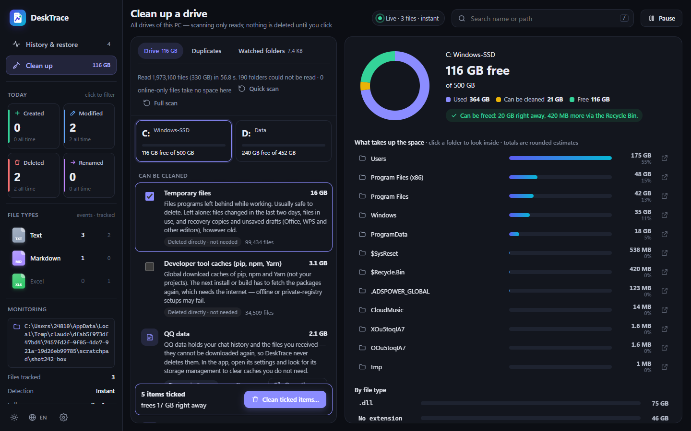
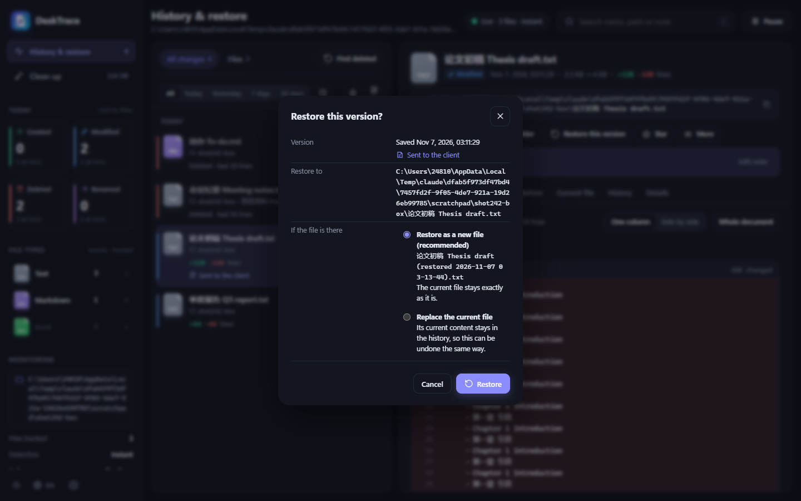
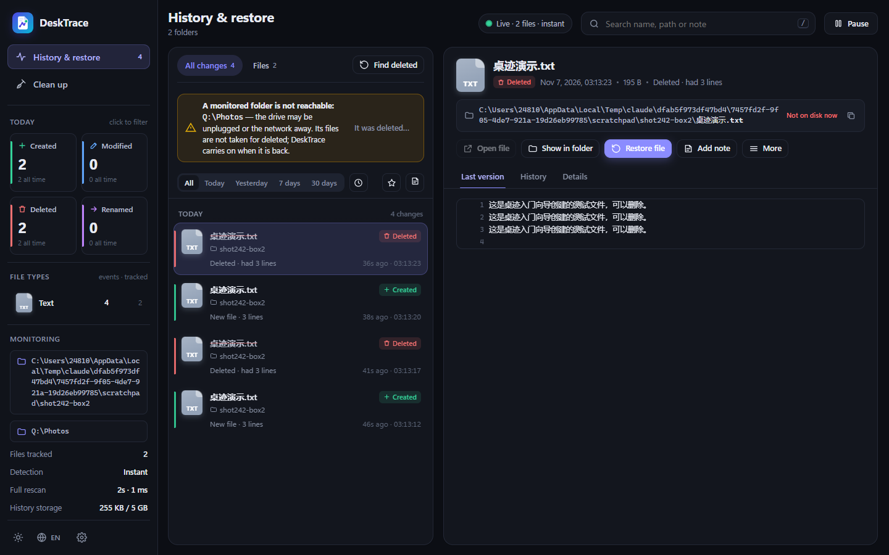
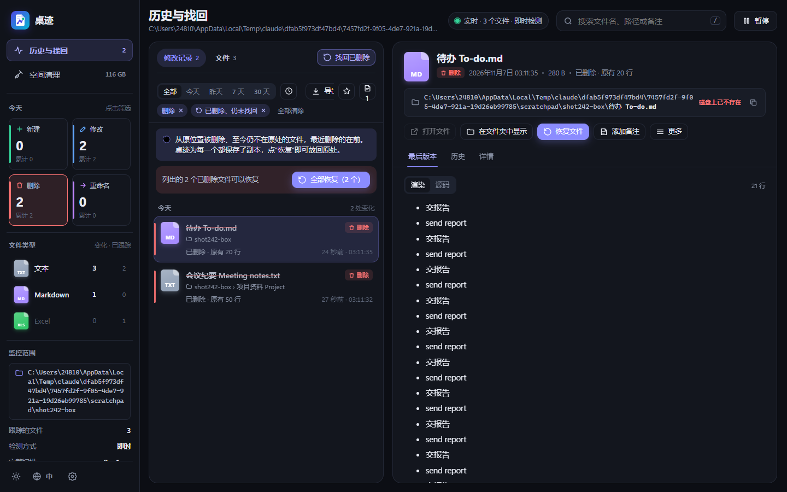
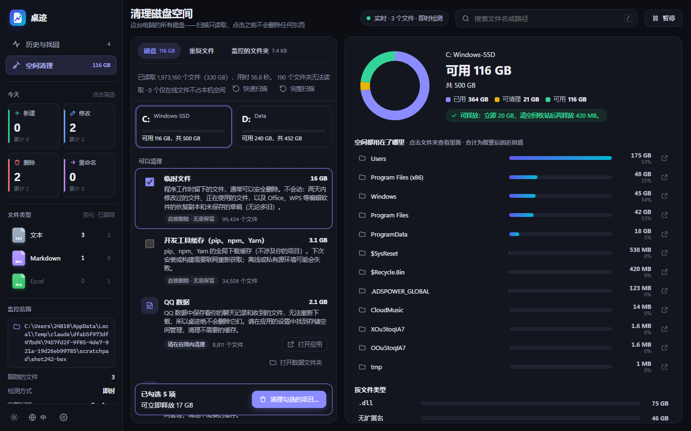

<p align="center"></p>

<h1 align="center">DeskTrace · 桌迹</h1>

<p align="center">
  <b>Undo for your files, and a clear view of what fills your disk — for Windows 10/11.</b><br>
  Every version of the files in your folders is kept, so a deleted or overwritten file can be brought back in two clicks.
</p>

<p align="center">
  <a href="https://github.com/salongc123-creator/DeskTrace/releases/latest"></a>
  
  
  <a href="LICENSE"></a>
</p>

<p align="center"><a href="#中文">中文说明</a> · <a href="CHANGELOG.md">Changelog</a> · <a href="https://github.com/salongc123-creator/DeskTrace/releases/latest">Download</a></p>



## What it does

**History & restore**
- Watches the folders you choose (your Desktop and Documents by default) and keeps a copy of **every version** of every file — compressed and de-duplicated.
- **Find deleted** lists every file that was deleted and is still missing; **Restore** puts it back where it was, or as a new copy next to it. Restoring never overwrites anything unless you ask for it, and a file open in another program is left untouched.
- See **exactly what changed** between versions of Word, Excel, PowerPoint, PDF, Markdown, text and code files, and preview images and archives.
- Search by name or by **content** (Chinese included). Add notes to versions, star files, export the list to Excel.
- An unplugged drive or a network folder that is away is never taken for "everything deleted".

**Clean up**
- Shows what takes up the space on any drive, with charts by folder and file type, and the biggest files.
- For each item it says **what deleting it means** (system file, program, synced cloud file, your own file, safe cache) and only offers what is safe. Your own files go to the Recycle Bin, and a cleanup can be **put back** later.
- Temporary files changed in the last two days, files in use, and recovery copies or unsaved drafts of Office and WPS are never touched.

**Quiet by design**
- Runs in the background at low priority: about 0.06 s of CPU per minute when idle; full drive reads use up to 4 worker processes only while you wait.
- Everything stays on your PC. No account, no cloud, no telemetry. The window talks only to a local service on `127.0.0.1`.
- English and 简体中文.

| Find deleted files | Clean up |
|---|---|
|  |  |
| **Restore safely** | **A drive that went away** |
|  |  |

## Download and install

1. Download **`DeskTrace-Setup-<version>.exe`** from the [latest release](https://github.com/salongc123-creator/DeskTrace/releases/latest).
2. Run it. It installs for your Windows account only (no administrator rights needed) into `%LOCALAPPDATA%\Programs\DeskTrace`; the history lives separately in `%LOCALAPPDATA%\DeskTrace`.
3. A short guide shows you how to restore a deleted test file.

The installer contains its own trimmed Python runtime, so nothing else is needed. Windows SmartScreen may warn about an unknown publisher because the installer is not code-signed; choose *More info → Run anyway* if you trust this release.

### Updates
New versions are delivered as signed **version licenses** (`DeskTrace <version>.dtlicense`), attached to each release. In DeskTrace open *Settings*, click **Choose license file…**, pick the license and choose the version to install. Licenses are cumulative and checked against the public key built into DeskTrace; the history and settings are kept. A new installer replaces the program and keeps your data too.

## Run from source

DeskTrace uses only the Python 3.12 standard library (plus the optional pure-Python `pypdf` for PDF text).

```bat
git clone https://github.com/salongc123-creator/DeskTrace.git
cd DeskTrace\desktop_watch
python server.py
```

Useful options: `--data <folder>` (a separate history folder, handy for trying things out), `--port <n>`, `--no-tray`, `--no-browser`.

Build the installer (needs [Inno Setup 6](https://jrsoftware.org/isinfo.php)):

```bat
python installer\build_installer.py
```

Version licenses are signed with a private release key that is **not** part of this repository, so builds made from source cannot create licenses that official installations accept.

## How it works

| Part | File |
|---|---|
| Local service, monitoring, history store (SQLite WAL + FTS5), restore, API | `desktop_watch/server.py` |
| Windows change notifications (`ReadDirectoryChangesW`) | `desktop_watch/winwatch.py` |
| Drive scan and Clean up (consequences, Recycle Bin, cloud placeholders) | `desktop_watch/cleaner.py` |
| Text from Word, Excel, PowerPoint, PDF and more | `desktop_watch/extractors.py` |
| Window (WebView2), tray icon | `desktop_watch/window.py`, `desktop_watch/tray.py` |
| Version licenses (verification) | `desktop_watch/updates.py` |
| User interface | `desktop_watch/static/` |
| Installer, release tooling, changelog | `installer/` |

More detail: [desktop_watch/README.md](desktop_watch/README.md).

## Privacy

DeskTrace never sends anything anywhere. Copies of your files are stored only in `%LOCALAPPDATA%\DeskTrace` on your PC; you choose how long they are kept and how much space they may use, and Settings can back them up or delete them.

## Contributing and support

Bug reports and ideas are welcome — see [CONTRIBUTING.md](CONTRIBUTING.md). Security issues: see [SECURITY.md](SECURITY.md).

## License

[MIT](LICENSE)

---

<a id="中文"></a>

## 中文

**桌迹**是一款 Windows 10/11 桌面软件：**给文件加上“撤销”**，并**看清磁盘空间被什么占用**。

**历史与找回**
- 监控你选择的文件夹（默认是桌面和文档），为每个文件的**每一个版本**保存副本（压缩、去重）。
- **找回已删除**：列出所有被删除、至今仍不在原处的文件，点“恢复”即可放回原处，或在旁边另存一份。除非你选择替换，恢复永远不会覆盖任何文件；文件正被其他程序打开时保持原样。
- 精确对比 Word、Excel、PowerPoint、PDF、Markdown、文本和代码文件各版本之间**改了哪里**，可预览图片和压缩包。
- 按文件名或**内容**搜索（支持中文）；为版本添加备注、为文件加星标、导出 Excel。
- 移动硬盘拔出或网络文件夹断开，绝不会被当作“全部删除”。

**空间清理**
- 显示任意磁盘的空间用途：按文件夹、按文件类型的图表，以及最大的文件。
- 每一项都写明**删除意味着什么**（系统文件、程序、云同步文件、你自己的文件、可安全删除的缓存），只提供安全的操作；你自己的文件移到回收站，之后可以**放回原处**。
- 两天内修改过的临时文件、正在使用的文件，以及 Office、WPS 的恢复副本和未保存的草稿，一律不动。

**安静、本地**
- 后台低优先级运行，空闲时每分钟约 0.06 秒 CPU。
- 所有数据只保存在你的电脑上：无需账号，不上传，不收集任何信息。

**安装：** 从 [最新发布](https://github.com/salongc123-creator/DeskTrace/releases/latest) 下载 `DeskTrace-Setup-<版本>.exe` 运行即可（无需管理员权限）。**更新：** 下载发布中附带的 `.dtlicense` 版本许可证，在“设置”中点“选择许可证文件…”选择它。

| 找回已删除 | 空间清理 |
|---|---|
|  |  |

许可证：[MIT](LICENSE)
